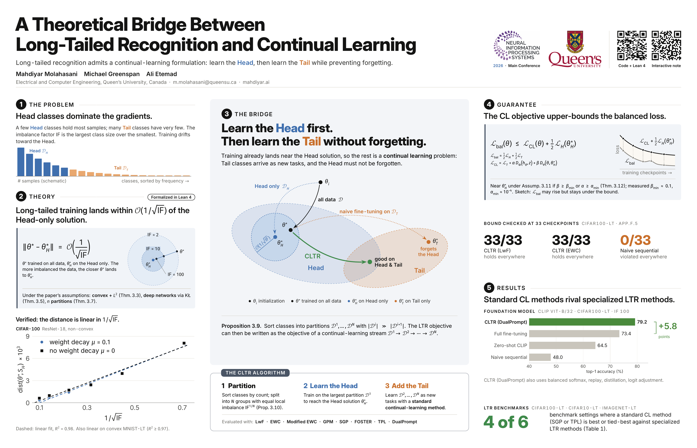
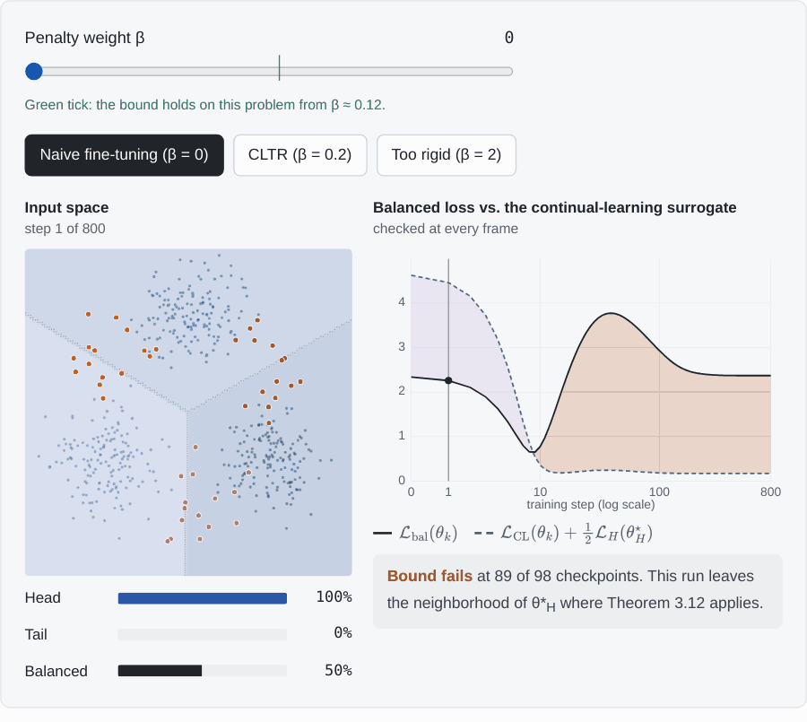

# A Theoretical Bridge Between Long-Tailed Recognition and Continual Learning

**Mahdiyar Molahasani, Michael Greenspan, Ali Etemad** · Queen's University

**NeurIPS 2026**

[Paper](https://openreview.net/forum?id=wERJT1NgQB) | [NeurIPS page](https://neurips.cc/virtual/2026/loc/paris/poster/148638) | [Poster](assets/poster.png) | [Slides](https://neurips.cc/media/neurips-2026/Slides/148638.pdf) | [Interactive note](https://mahdiyar.ai/posts/cltr)

[](assets/poster.png)

Official code and Lean 4 proofs for the paper. Long-tailed recognition admits a
continual-learning formulation: learn the Head classes first, then learn the Tail
classes while preventing forgetting.

## Try it yourself

<p align="center">
  <a href="https://mahdiyar.ai/posts/cltr"></a>
</p>

Stage two of CLTR on a toy problem. Naive fine-tuning on the Tail forgets the Head
(Head 0%, Tail 100%); CLTR learns the Tail and keeps the Head (Head 91%, Tail 94%).
**[Run it in your browser →](https://mahdiyar.ai/posts/cltr)** Every figure in the
interactive note trains live, so you can change the imbalance factor and the penalty
weight yourself.

## Proofs (`proofs/`)

Lean 4 + Mathlib formalization of the theory. No `sorry`; every theorem depends only on
Lean's standard axioms.

```bash
cd proofs
lake exe cache get
lake build
lake env lean AxiomCheck.lean
```

| Paper | Lean | File |
|---|---|---|
| Loss decomposition, γ in terms of IF | `avgLoss_union_gamma`, `gamma_eq_IF`, `one_sub_gamma_le` | `Data.lean` |
| Lemma C.1 | `lemmaC1`, `lemmaC1'`, `quadratic_growth_of_strongConvexOn` | `Convex.lean` |
| Theorem 3.3 | `theorem3_3_sq`, `theorem3_3_bound`, `theorem3_3` | `Convex.lean` |
| Theorem 3.5 | `head_excess_le`, `dist_le_of_perturbation`, `theorem3_5_bound`, `theorem3_5` | `Nonconvex.lean` |
| Theorem 3.7 | `theorem3_7`, `theorem3_7_data`, `tail_mass_le`, `objective_union` | `Nonconvex.lean`, `Data.lean` |
| Remark 3.8 | `risk_decomposition`, `remark3_8_bound`, `remark3_8`, `boundary_IF` | `ExpDecay.lean` |
| Proposition 3.9 | `prop3_9_ltr_eq_cl_objective` | `Data.lean` |
| Proposition 3.10 | `task_sub_bal_le`, `tv_le`, `bal_penalty_le`, `forgetting_le`, `equal_boundaries_optimal`, `optimal_N_antitone`, `exists_optimal_N` | `Partitioning.lean` |
| Theorem 3.12 | `theorem3_12_param`, `theorem3_12_output`, `theorem3_12`, `bregman_nonneg` | `CLGuarantee.lean` |
| Proposition C.2 | `propC2_exact_balanced`, `propC2_exact_balanced_minimizers` | `CLGuarantee.lean` |

## Experiments (`experiments/`)

CLTR (SGP) on CIFAR-100/10-LT with ResNet-32, and CLTR (DualPrompt) with CLIP ViT-B/32.

```bash
cd experiments
pip install -r requirements.txt
python main.py cifar --config configs/cifar/c100_if100.yaml --seed 0
python main.py clip --config configs/clip/if100.yaml --seed 0
./run.sh   # all configurations, seeds 0-2
```

## Citation

```bibtex
@inproceedings{molahasani2026theoretical,
  title     = {A Theoretical Bridge Between Long-Tailed Recognition and Continual Learning},
  author    = {Molahasani, Mahdiyar and Greenspan, Michael and Etemad, Ali},
  booktitle = {Advances in Neural Information Processing Systems (NeurIPS)},
  year      = {2026}
}
```
